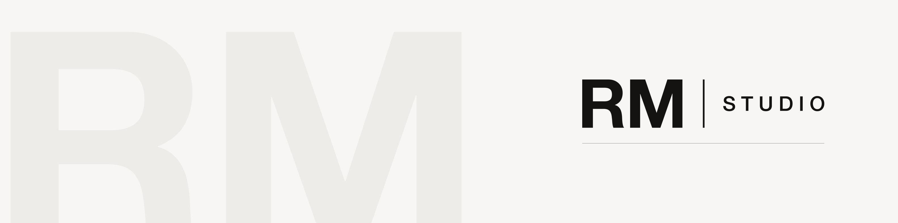
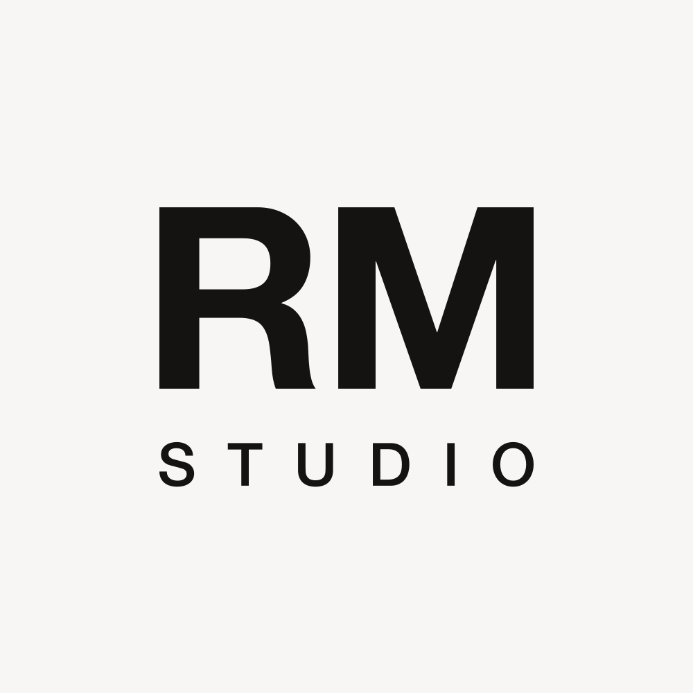

 

**레거시를 클라우드로, 데이터를 안전하게, 아이디어를 제품으로.** 
LEGACY TO CLOUD · DATA MOVED SAFELY · IDEAS INTO PRODUCTS

 

 

## 01 — About

**알엠스튜디오**는 엔터프라이즈 시스템의 **클라우드 이관 · 아키텍처**, 대규모 **데이터 마이그레이션**, **웹 서비스 구축**을 수행하는 IT 서비스 기업입니다.
ERP · 그룹웨어 · 커머스 · 공공/협회 시스템까지 여러 산업의 현장 경험을 바탕으로 분석부터 설계, 개발, 이행, 운영 안정화까지 책임집니다.
프로젝트에서 검증한 기술은 오픈소스와 자체 서비스로 만들어 공개합니다.

> **RM Studio** is an IT services company specializing in **cloud migration & platform architecture**, large-scale **data migration**, and **web platform development** — taking ownership from analysis and design through delivery and stabilization.

 

## 02 — What We Do

<table>
<tr>
<td width="50%" valign="top">

**Cloud & Architecture** 
레거시 IDC → 클라우드 이관, AA/SA 아키텍처 컨설팅

</td>
<td width="50%" valign="top">

**Middleware Modernization** 
WebLogic/OHS → Tomcat/Nginx 런타임 전환

</td>
</tr>
<tr>
<td valign="top">

**Data Migration** 
Oracle · MSSQL → MySQL 이기종 이관, 쿼리 튜닝

</td>
<td valign="top">

**ERP & Groupware** 
ERP · 그룹웨어 · 전자결재 구축 및 고도화

</td>
</tr>
<tr>
<td valign="top">

**Web Platform** 
웹 서비스 기획 · 개발 · 퍼블리싱, 반응형 웹 · SEO

</td>
<td valign="top">

**Project Management** 
PM · PL · 기술 컨설팅, Agile 수행

</td>
</tr>
</table>

 

## 03 — Projects

| Year | Project | Scope |
|:---:|---|---|
| `2026` | **삼성웰스토리 E-커머스 플랫폼 통합** Samsung Welstory E-Commerce Platform Integration | AA / SA · PL |
| `2026` | **한국무역협회 프로젝트** Korea International Trade Association | — |
| `2025 – 2026` | **애경그룹 그룹웨어 고도화 2차** AK Group Groupware Enhancement Phase 2 | Data Migration |
| `2025` | **네이버 데이터랩 연동 쇼핑데이터 열람 서비스** Naver Datalab Shopping Data Viewer | Planning · PM |

<b>삼성웰스토리 E-커머스 플랫폼 통합</b> — Legacy IDC → Samsung Cloud Platform

 

삼성웰스토리 E-커머스 플랫폼의 Legacy IDC 서비스를 **Samsung Cloud Platform**으로 이관하고, WebLogic/OHS 기반 구조를 **Tomcat/Nginx**로 전환하고 있습니다.

- **아키텍처:** Legacy IDC 애플리케이션/시스템 구조 분석, 클라우드 이관 구조 검토
- **산출물:** 구조도, 상세분석서, 개발가이드
- **인프라:** 방화벽 정책 분석, 네트워크 변경 협의
- **개발 · 배포:** 변경된 런타임에 맞춘 소스 수정, Bamboo · Bitbucket 기반 배포 · 릴리즈 관리
- **PL:** 10명 규모 수행 조직의 업무 조율과 개발 지원

<b>애경그룹 그룹웨어 고도화 2차</b> — MSSQL → MySQL (Azure)

 

전자결재와 계열사 게시판 시스템의 **MSSQL → MySQL(Azure)** 대규모 데이터 이관을 전담해 일정 내에 완료했습니다.

- **분석:** SQL Server 2016 SP1 레거시 데이터 모델 분석, AS-IS 문서화
- **설계:** MySQL 8.0 TO-BE 스키마 설계, 도메인 · 테넌트 · 기간 단위 이관 전략 수립
- **재설계:** 기존 프로시저와 C# 프로그램을 분석해 이관 로직 재설계
- **개발 · 이행:** Spring Boot · Spring Batch 이관 프로그램 개발, 실행 계획 수립과 실제 이관 수행

<b>네이버 데이터랩 연동 쇼핑데이터 열람 서비스</b> — Data-driven Web Platform

 

네이버 데이터랩 API로 실시간 쇼핑 트렌드 데이터를 열람하는 웹 플랫폼을 구축했습니다.

- 서비스 기획, 데이터 수집 로직과 UI 흐름 설계 (Figma · Next.js)
- 개발 · 디자인 협업 체계 구성, 일정 관리와 산출물 검수

 

## 04 — Open Source

<table>
<tr>
<td>

### [Georu](https://github.com/dvmoomoodv/georu-data-migration)
**거룻배처럼, 데이터를 나눠 안전하게 나르는 DB 이관 프레임워크**

알엠스튜디오가 실제 이관 프로젝트(Oracle → MySQL, MSSQL → MySQL)에서 사용한 엔진을 고객사 코드와 분리해 공개한 **Spring Batch 기반 DB 이관 프레임워크**입니다.
변환 규칙(SQL · Java)만 작성하면 실행 · 안전장치 · 기록 · 보고는 프레임워크가 맡습니다.

- 실행 게이트, 실행 전 점검, 4단계 테스트 모드. TRUNCATE · DELETE는 실행하지 않음
- 청크 단위 진행률, 실행 이력, 보고서(JSON · CSV · XLSX · PDF)
- 운영 UI와 REST API

</td>
</tr>
</table>

 

## 05 — Tech Stack

| | |
|---|---|
| **Languages** |        |
| **Backend** |          |
| **Frontend** |           |
| **Database** |     |
| **Cloud & Infra** |            |
| **DevOps & VCS** |       |
| **Enterprise** |      |
| **Design** |   |

<b>EXPERTISE</b> — Database Migration · Query Tuning · Java Performance · Cloud Migration · Web Application Architecture · UI Component Development · Responsive Web · SEO · ITGC · Agile · Software Project Management & Consulting

 

## 06 — Contact

<table>
<tr>
<td width="140" align="center">

</td>
<td>

프로젝트 문의와 협업 제안은 언제든 환영합니다. 
We're always open to new projects and collaborations.

✉️ [dvmoomoodv@gmail.com](mailto:dvmoomoodv@gmail.com)

</td>
</tr>
</table>

 
© RM STUDIO · 알엠스튜디오

